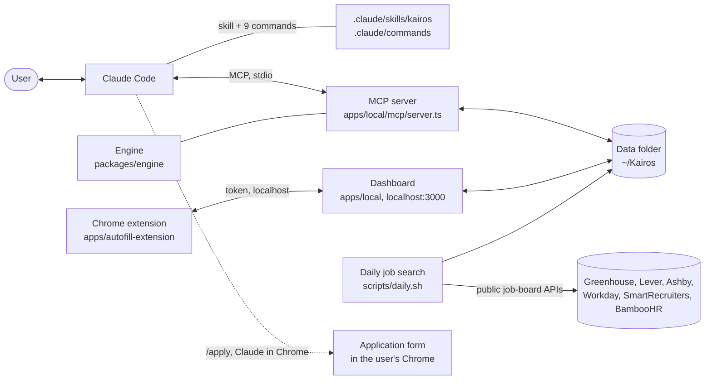

# How Kairos Kit works

This page explains how the parts of the kit fit together, where the user's data
lives, how one application moves from a posting to a submitted form, and which
controls keep the output true to the user's own record. The design decisions
behind it are in [`docs/adr`](adr/README.md).

## The parts



| Part | What it does | Where |
|---|---|---|
| Claude Code | The agent. It talks with the user, follows the skill and calls the MCP tools. The kit adds no agent loop of its own. | — |
| Skill and commands | The workflows in plain language: building the record, scoring, tailoring, cover letters on request, application answers, interview prep, form filling. | `.claude/skills/kairos/SKILL.md`, `.claude/commands/*.md` |
| MCP server | 46 tools that read and write the data folder. Each tool that needs judgment returns the evidence and the prompt; Claude Code writes the result, and the matching `save_*` tool checks it in code before anything is written. | `apps/local/mcp/server.ts` |
| Engine | The code the server, the dashboard and the scripts share: scoring evidence, résumé checks, rendering, the job search, the record's health check. No model calls. | `packages/engine` |
| Data folder | Everything about the user, as Markdown and JSON files. Outside the repository. | `KAIROS_HOME`, default `~/Kairos` |
| Dashboard | A local web page over the data folder: the board, the record, sourced roles, the funnel. It answers only on this computer. | `apps/local/app` |
| Daily job search | Reads public job-board APIs, filters and ranks postings against the user's search profile, and puts the best on the board as Sourced. | `scripts/daily.sh`, `apps/local/scripts/sourcing-run.mts`, `packages/engine/sourcing` |
| Chrome extension | Optional. Fills Greenhouse, Lever and Ashby forms from the record. | `apps/autofill-extension` |

Model calls happen in two places only. Claude Code, under the user's own Claude
plan, does the conversation and the writing. A few unattended steps (the daily
search's triage, the dashboard's résumé and form-mapping buttons) run
`claude -p` on the same plan, with no tools and no MCP servers
(`apps/local/lib/claude-cli.ts`). The kit sends nothing to any other server.

## The data folder

```
~/Kairos/
  profile.md                      name, contact line, headline, target roles, preferences
  autofill.json                   standing answers for forms (address, work authorization, EEO if shared)
  setup-state.json                which /setup sections are done, and the documents read
  knowledge-base/
    experiences/NN-company-role.md  one file per role: facts with their source tags
    education/*.md
    metrics-register.md           every number, with its source and whether it can be used
    star-stories.json             interview stories built from the record
    _writing-samples.md           the user's own writing, for style only
  applications/<id>/
    application-meta.json         company, role, status, dates
    job-ad-snapshot.md            the posting as captured
    score.json, score-report.json fit score and the evidence behind it
    resume.json, resume.docx, resume.pdf   the tailored résumé, with its coverage table
    questions.json, cover-letter.*         application answers; a letter only when asked
  sourcing/
    search-profile.json           titles, places, exclusions, schedule for the daily search
    last-run.json, backlog.json, seen.json   results, the Sourced column, every posting already seen
  _index.json                     the board's index (rebuilt by rebuild_index)
  logs/
```

Every fact in an experience file carries a source tag:

| Tag | Meaning |
|---|---|
| `[R]` | Read from a document the user provided (résumé, LinkedIn export, transcript). |
| `[C]` | Confirmed by the user in conversation. |
| `[?]` | Extracted but not verified. Code removes these before any evidence reaches a model (ADR 0004). |

The files are plain text so the user can read and correct them. They change
only through the MCP tools; a direct edit needs `rebuild_index` afterwards.

## One application, start to finish

1. **Sourced.** The daily search fetches postings from about 14,700 public
   company job boards (`packages/engine/sourcing/registry.json`), applies the
   search profile's filters in code (`filter.ts`), ranks what is left, and sends
   the top of the list to a short triage call. Kept postings appear on the
   board as Sourced. A posting can also come from a link the user pastes
   (`capture_job_ad`).
2. **Scored.** `/score` reads the posting, gets the user's evidence with
   `get_scoring_evidence` (unverified facts already removed), and saves a fit
   score with the gaps (`save_score`). Text from the posting is cleaned of
   hidden markup first (`posting-guard.ts`).
3. **Tailored.** `/tailor` gets the generation evidence, writes the résumé, and
   calls `save_resume`. The save is refused if a coverage row quotes text that
   is not on the résumé, or if the résumé uses a phrasing the record forbids.
   The result lists bullets whose claim of ownership no verified fact supports
   ("stretch check"); the user keeps, softens or drops each one.
   `check_resume_layout` renders the file and checks page count, the page
   break and the text a hiring system reads.
4. **Answers and letter.** Application questions draw on earlier approved
   answers (`search_qa_bank`). A cover letter is written only when the user asks.
5. **Applied.** `/apply` fills the form in the user's Chrome one page at a time
   from `get_form_profile`, shows its plan, and stops at the review page. The
   user submits. `set_application_status` records it.
6. **After.** `/prep` builds interview preparation from the record. The board and
   the funnel page track every application to its outcome.

## Controls

The kit reads text it does not control (job postings, application forms, web
pages) and writes documents that go out under the user's name. These controls
keep the two apart.

| Risk | Control | Where |
|---|---|---|
| A made-up fact in a résumé | Résumés are written only from the record; numbers must appear word for word in their source; coverage rows must quote the résumé; ownership claims need a verified fact. The checks are code, not a model's judgment. | `save_resume` in `apps/local/mcp/server.ts`; `packages/engine/stretch.ts`; ADR 0002 |
| A posting that tells Claude to add a fact to the record | Every save to the record (`save_confirmed_fact`, `save_experience`, `save_education`, `save_metric`, `save_profile`) shows the user exactly what is new in a Claude Code confirmation the model cannot answer. Nothing is saved without the user's Accept. | `apps/local/lib/record-confirm.ts`; ADR 0003 |
| Unverified facts reaching a model | `[?]` facts are removed in code before evidence is returned. | ADR 0004 |
| Hidden text in a posting | Hidden elements and markup are removed before the text is used; a page that is mostly hidden is refused. | `packages/engine/posting-guard.ts` |
| A link that points at this computer or the local network | Only http and https; hosts on this computer or a private network are refused, and every redirect is checked again. | `packages/engine/safe-fetch.ts` |
| A request to read a private file | `prepare_extraction` reads only résumés, transcripts and LinkedIn exports: no hidden files or folders (after links are resolved), 25 MB at most. | `apps/local/lib/source-docs.ts` |
| Another website reaching the dashboard | The dashboard listens on 127.0.0.1 only, refuses a Host header that is not this computer, and refuses a change that comes from another site's page. | `apps/local/middleware.ts`, `scripts/dashboard.sh` |
| An unattended model call acting on posting text | `claude -p` runs with no tools, no MCP servers and no saved session; the prompt goes in on stdin. | `apps/local/lib/claude-cli.ts`, `apps/local/scripts/sourcing-run.mts` |
| The extension filling the wrong page | Only the page itself, or a frame on a supported job site, is filled; it never clicks a submit button or a link. Its local endpoints need a token stored readable by the user only. | `apps/autofill-extension/content.js`, `apps/local/lib/autofill.ts` |
| A form submitted without the user | `/apply` and the extension never submit. The user clicks Submit. | `.claude/commands/apply.md` |
| The PDF renderer running page content | Chrome keeps its sandbox; the page runs no JavaScript and loads nothing from the network. | `apps/local/lib/pdf.ts` |
| Personal data in this repository | The data folder is outside the repository, and a personal-data scan runs on every push. | `scripts/privacy-scan.mjs`, `.github/workflows/ci.yml` |

What the controls do not cover is in [SECURITY.md](../SECURITY.md).

## Where to look

| To change… | Start in |
|---|---|
| A workflow's steps or wording | `.claude/skills/kairos/SKILL.md` and the command in `.claude/commands` |
| A tool's input, output or checks | `apps/local/mcp/server.ts` |
| Scoring evidence | `packages/engine/pipeline.ts`, `packages/engine/prompts` |
| Résumé checks and rendering | `packages/engine/stretch.ts`, `length-policy.ts`, `resume-render.ts`, `docx-render.ts`, `ats-text.ts` |
| The record's health check | `packages/engine/health.ts` |
| `/setup` sections | `packages/engine/setup/sections.ts` (the checklist in `docs/kit-setup-checklist.md` is generated from it) |
| The job search | `packages/engine/sourcing` (`sweep.ts`, `filter.ts`, `backlog.ts`), `apps/local/scripts/sourcing-run.mts` |
| The dashboard | `apps/local/app`, `apps/local/components`, `apps/local/lib/dashboard.ts` |
| Data folder reads and writes | `apps/local/store/local-fs.ts` |
| Evaluation cases | `evals/` |

Tests are in `tests/` (`npm test`); the typecheck is `npm run typecheck`.
